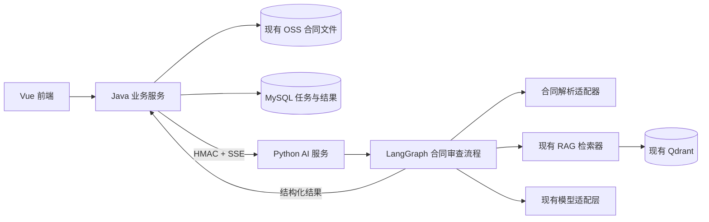
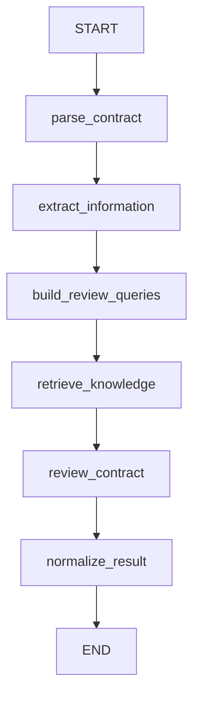

# 合同智能体第一版设计方案

实现及部署步骤见 [第一版实现说明](../main-service/docs/合同智能体第一版实现说明.md)。机器协议以 [Pydantic 导出的共享契约](../main-service/docs/contracts/contract-review-v1/README.md) 为准；以下结构示例只用于说明业务含义。

## 1. 文档目的

本文档用于明确合同智能体第一版的产品范围与技术设计。

第一版遵循以下原则：

> 功能范围做最小，技术结构不做一次性。

第一版只实现合同审查的核心能力，不提前开发非必要功能；同时通过稳定的数据结构、模块边界和扩展接口，为后续合同问答、合同改写、人工审核、多智能体等能力保留扩展空间，避免后续推倒重写。

## 2. 第一版建设目标

用户上传一份合同并选择审查条件后，系统能够：

1. 解析合同正文并保留原文位置。
2. 提取合同关键信息。
3. 结合现有 RAG 能力识别主要合同风险。
4. 展示风险对应的合同原文和修改建议。

第一版的核心业务闭环如下：

```text
上传合同
→ 选择我方立场和合同类型
→ 解析合同
→ 提取关键信息
→ 检索审查知识
→ 审查合同风险
→ 展示审查结果
```

## 3. 第一版核心功能

### 3.1 创建合同审查

支持用户：

- 上传 PDF、DOCX 合同。
- 选择我方立场：甲方、乙方或中立。
- 选择合同类型。
- 发起合同审查任务。

### 3.2 合同解析与信息提取

信息提取作为独立处理方式提供，不自动执行风险审查。支持 PDF、DOCX，扫描件支持扫描 PDF、PNG 和 JPEG。系统解析合同正文，并尽可能保留：

- 页码。
- 条款编号。
- 章节结构。
- 原文位置。

第一版提取以下常用字段：

- 合同名称。
- 甲方、乙方及其他主体。
- 合同金额。
- 合同期限。
- 付款方式。
- 交付与验收。
- 违约责任。
- 合同解除条件。
- 争议解决方式。

### 3.3 合同风险审查

第一版重点审查以下风险：

- 付款风险。
- 交付与验收风险。
- 违约责任风险。
- 合同解除风险。
- 保密风险。
- 争议解决风险。
- 关键条款缺失。
- 前后内容冲突。

每条风险统一输出以下内容：

- 风险分类。
- 风险等级。
- 风险标题。
- 风险说明。
- 合同原文。
- 原文位置。
- 修改建议。
- 判断依据。

### 3.4 查看审查结果

审查结果页面提供：

- 合同基本信息。
- 风险数量汇总。
- 风险明细列表。
- 风险对应的合同原文。
- 风险对应的修改建议。

第一版不单独开发复杂报告导出、人工审批和用户反馈功能。

## 4. 第一版明确不开发的功能

以下功能不属于第一版范围：

- 多智能体协作。
- 合同问答。
- 用户反馈与模型学习闭环。
- 人工审批工作流。
- 动态工作流配置。
- 自定义审查规则平台。
- 合同自动改写。
- 合同版本对比。
- 历史合同对比。
- 合同自动起草。
- 合同谈判助手。
- 合同履约提醒。
- 长期记忆。
- MCP 写操作。
- 任务取消和断点恢复。

这些能力后续按实际业务需求逐步增加，不在第一版提前建设。

## 5. 总体技术架构

合同智能体沿用当前项目的 Java 主服务与 Python AI 服务边界。



### 5.1 当前技术基线与集成结论

| 层级 | 当前技术与可复用能力 | 第一版使用方式 |
| --- | --- | --- |
| 用户前端 | Vue 3、TypeScript、Vite、Element Plus、Pinia、UnoCSS、流式请求能力 | 新增合同审查页面，复用请求、路由、鉴权和组件规范 |
| Java 业务服务 | Java 17、Spring Boot 3.5、MyBatis-Plus、Sa-Token、Redis、MySQL、OSS | 管理权限、文件、任务、状态与结果，作为唯一业务入口和业务库写入方 |
| Python AI 服务 | Python 3.14、FastAPI、Pydantic v2、LangChain、LangGraph | 执行合同解析、RAG 检索和结构化审查流程 |
| RAG | Qdrant、稠密/稀疏检索、RRF、重排、引用 | 检索制度、标准条款、模板和审查知识，不存储合同原文 |
| 服务间通信 | Service Token、HMAC、时间戳、Nonce、现有 HTTP/SSE 客户端 | Java 调用 Python 内部流式接口，沿用现有签名与错误协议 |
| 文件存储 | 现有 OSS 文件体系和签名 multipart | Java 管理原文件，Python 只取得本次执行副本 |

第一版只需要集成以下已有技术，不再引入新框架：

1. 已直接集成的 LangGraph，用于固定合同审查流程编排。
2. Pydantic v2，用于请求、状态、合同信息、风险和最终结果校验。
3. 现有 LangChain 模型适配层及其结构化输出能力。
4. 现有 RAG 检索链路，不新增向量数据库。
5. 现有 Java/Python HTTP/SSE、OSS、MySQL 和权限体系。

第一版不增加 Kafka、WebSocket、Celery、Temporal、独立合同微服务、LangGraph Platform 或新的模型 SDK。

### 5.2 Java 业务服务职责

- 管理用户、权限和合同文件。
- 创建合同审查任务。
- 查询任务状态。
- 调用 Python AI 服务。
- 保存合同信息和风险结果。
- 向前端提供业务接口。
- 根据 Agent 配置和用户权限生成模型、知识范围和运行预算快照。

### 5.3 Python AI 服务职责

- 执行 LangGraph 合同审查流程。
- 调用文档解析能力。
- 调用现有 RAG 能力。
- 调用大模型。
- 提取合同信息。
- 识别合同风险。
- 将模型结果转换为统一结构。

Java 服务只依赖稳定的请求和结果协议，不依赖 LangGraph 内部节点。后续智能体流程发生变化时，不应要求 Java 服务和前端同步重构。

Python 不处理终端用户身份、不访问业务 MySQL、不保存业务结果。合同文件由 Java/OSS 管理；Python 只通过本次签名 multipart 取得文件，执行后删除临时副本。合同原文不自动写入知识库或 Qdrant。

## 6. LangGraph 流程设计

第一版使用固定、可追踪的工作流，不使用自由规划、循环反思和多智能体。



各节点职责如下：

| 节点 | 职责 |
| --- | --- |
| `parse_contract` | 解析合同正文、章节和原文位置 |
| `extract_information` | 提取合同主体、金额、期限等字段 |
| `build_review_queries` | 按固定审查维度生成检索查询，不让模型自由规划 |
| `retrieve_knowledge` | 调用现有 RAG 检索审查依据 |
| `review_contract` | 基于合同、立场和知识证据执行结构化风险审查 |
| `normalize_result` | 去重、校验原文引用、排序并生成最终结果 |

第一版不增加 `save_result` 节点。LangGraph 只产出结构化结果，由 Java 校验后统一持久化。

### 6.1 Graph 状态

Python 内部状态只保存本次运行真正需要的数据：

```python
class ContractReviewState(TypedDict, total=False):
    request: ContractReviewExecutionRequest
    document: ContractDocument
    information: ContractInformation
    review_query: str
    evidences: list[KnowledgeEvidence]
    draft_findings: list[ContractFindingDraft]
    result: ContractReviewResult
    warnings: list[str]
```

状态字段使用强类型模型，不使用无约束 `dict[str, Any]`。文件字节、模型客户端和数据库连接不放入 State；Parser、Retriever 和 Provider 通过 Graph 构建函数注入。

### 6.2 执行策略

- 单 Graph、固定顺序、无循环、无多智能体。
- 第一版单次执行，不启用 LangGraph Checkpoint。
- 第一版不自动重试模型调用；失败后由用户显式重新发起任务，避免隐式增加模型消耗。
- 文件不支持、无权限、正文为空等业务错误不重试。
- 执行失败后保留失败任务，用户重新发起新任务，不做跨进程断点恢复。

## 7. 核心数据结构

第一版需要稳定以下三个核心对象。

### 7.1 ReviewRequest

`ReviewRequest` 表示一次合同审查请求。

```json
{
  "schemaVersion": "1.0",
  "taskId": "190000000000000001",
  "requestId": "contract-review-0001",
  "userId": "9",
  "fileName": "采购合同.pdf",
  "mediaType": "application/pdf",
  "partyPosition": "PARTY_A",
  "contractType": "PURCHASE",
  "modelProfile": {},
  "rag": {},
  "executionPolicy": {}
}
```

字段说明：

| 字段 | 说明 |
| --- | --- |
| `schemaVersion` | 跨服务协议版本 |
| `taskId` | Java 创建的审查任务标识 |
| `fileName` / `mediaType` | 文件元数据；字节随已签名 multipart 的 file 字段传输 |
| `partyPosition` | 我方立场 |
| `contractType` | 合同类型 |
| `modelProfile` | Java 根据 Agent 与权限生成的模型快照 |
| `rag` | Java 下发的授权知识范围 |
| `executionPolicy` | 当前运行的超时及输入、输出限制 |

模型、知识范围和运行限制均由 Java 解析，前端不能直接指定未授权资源。后续增加字段时优先增加明确的可选字段，不使用无约束的万能 `options`。

### 7.2 ContractContext

`ContractContext` 是智能体内部使用的合同上下文，主要包括：

- 合同正文。
- 合同章节。
- 原文位置。
- 提取字段。
- 审查参数。
- RAG 检索结果。
- 运行信息。

该对象只在 Python AI 服务内部使用，不直接暴露给前端。

合同关键信息第一版固定包含：合同名称、甲乙方、其他主体、金额与币种、生效/开始/结束日期、付款安排、交付验收、违约责任、解除终止和争议解决。无法确定的字段返回 `null`，金额使用字符串化十进制值，避免跨语言浮点精度问题。

### 7.3 Finding

`Finding` 表示一条合同风险结果。

```json
{
  "findingId": "F-001",
  "category": "PAYMENT",
  "severity": "HIGH",
  "title": "预付款比例过高",
  "description": "合同签订后需要支付全部合同款",
  "quote": "甲方应在合同签订后三日内支付全部价款",
  "location": {
    "pageNumber": 3,
    "clauseNumber": "第四条",
    "startOffset": 1260,
    "endOffset": 1284
  },
  "suggestion": "建议改为分阶段付款",
  "basis": "付款义务与对方履约进度未形成约束。",
  "evidences": []
}
```

风险等级固定为 `HIGH`、`MEDIUM`、`LOW`；风险分类使用可扩展字符串代码。每条正式风险必须包含能够在解析文本中校验的 `quote`，位置字段允许部分为空。知识证据包含来源类型、来源标识、标题和引用片段，不能虚构法规、案例或知识来源。前端通过统一风险组件展示 `Finding`，不针对每种风险单独开发页面。

### 7.4 ContractReviewResult

最终结果是 Python 交给 Java 的唯一正式业务输出：

```json
{
  "schemaVersion": "1.0",
  "taskId": "190000000000000001",
  "information": {},
  "findings": [],
  "summary": {
    "high": 0,
    "medium": 0,
    "low": 0
  },
  "warnings": [],
  "engineVersion": "contract-review-v1"
}
```

`warnings` 只记录不影响整体完成的降级信息，例如某个非关键字段无法提取；解析失败、权限失败或审查整体失败必须返回失败事件，不能伪装成空结果。

### 7.5 跨服务契约

跨 Java/Python 协议以 Python Pydantic 模型导出的 JSON Schema/OpenAPI 为基准，Java 使用明确 DTO 对齐，并通过契约测试防止字段漂移。稳定协议禁止使用 `Map` 或 `JSONObject` 承载。

所有请求与最终结果都携带 `schemaVersion`。新增可选字段保持向后兼容；删除字段、改变含义或字段类型时才升级主版本。

## 8. 核心扩展接口

扩展性通过稳定接口实现，而不是通过提前开发未来功能实现。

### 8.1 DocumentParser

负责将不同类型的合同文件解析为统一合同文档结构。

```text
输入：合同文件或文件标识
输出：正文、章节、页码和原文位置
```

后续增加 OCR 或其他文档解析方案时，只新增或替换 `DocumentParser` 实现。

第一版复用现有 `KnowledgeDocumentParser` 的底层解析能力，通过合同适配器转换成 `ContractDocument`。合同内容只作为本次执行输入，不自动索引到 Qdrant。

### 8.2 KnowledgeRetriever

负责调用现有 RAG 能力获取审查依据。

```text
输入：合同内容、合同类型、我方立场
输出：相关制度、模板、条款或知识片段
```

后续增加新的知识来源时，只增加对应适配实现。

### 8.3 StructuredModelProvider

负责调用现有模型并返回通过 Pydantic 校验的结构化结果。

```python
class StructuredModelProvider(Protocol):
    async def invoke_structured(
        self,
        *,
        messages: Sequence[BaseMessage],
        response_model: type[BaseModel],
        model_profile: ModelProfile,
    ) -> BaseModel:
        ...
```

实现优先使用当前 LangChain 模型适配器的结构化输出能力，不再引入 Instructor 等新的结构化输出框架，也不把截取模型 JSON 字符串作为正式实现。

第一版只保留 Parser、Retriever、Structured Provider 三个确有替换需求的边界，不建设能力注册中心、插件机制或空的 `ReviewCapability` 列表。新增风险类型通过审查分类、提示词和评测样例演进；当未来确实出现独立审查子流程时，再将 `review_contract` 演进为子图。

## 9. 最小数据设计

合同文件复用现有 OSS 数据，不新增合同文件表。第一版结果总是按任务整体写入和整体读取，不存在风险级分页、筛选、统计或人工处理需求，因此只新增一张业务表。

### 9.1 合同审查任务表

建议表名：`ai_contract_review_task`

核心字段：

| 字段 | 说明 |
| --- | --- |
| `id` | 任务ID |
| `file_oss_id` | 现有 OSS 文件ID |
| `file_name` / `agent_id` / `model_id` | 文件名称、实际智能体和执行模型 |
| `contract_type` | 合同类型 |
| `party_position` | 我方立场 |
| `status` | 任务状态：执行中、完成、失败 |
| `result_json` | 经过强类型 DTO 校验的完整审查结果 |
| `billing_json` | 账户预占、授权模型及累计用量的强类型计费快照 |
| `error_code` / `error_message` | 统一错误码与脱敏错误信息 |
| 审计字段 | 项目统一的创建人、创建时间、更新人、更新时间等 |

建议任务状态：

```text
RUNNING
COMPLETED
FAILED
```

第一版只有按主键查询详情，不为未来可能出现的列表和统计预建索引。`result_json` 只整体读写，并在 Java 边界转换为强类型 `ContractReviewResultDto`，业务代码不直接操作 JSON 节点。

当后续明确出现风险分页、按等级筛选、风险统计或人工逐条处理需求时，再将风险拆到 `ai_contract_review_finding` 表。该变化属于存储实现演进，不改变 `ContractReviewResult` 和前端详情协议。

第一版不建设风险明细表、证据表、反馈表、审批表、规则表、合同主数据表和 LangGraph Checkpoint 表。

### 9.2 数据写入与事务边界

- Java 复用 OSS 保存文件，在任务创建事务中预占账户额度，再调用 Python。
- Java/Python 长连接期间不持有数据库事务。
- Java 创建任务前完成检索授权；创建后立即提交执行，提交失败时记录失败终态。
- Java 收到完整结果并通过 DTO 校验后，在短事务中写入 `result_json` 和 `COMPLETED` 状态。
- 中途进度只通过 SSE 传递；累计模型用量单独写入计费快照。成功或失败均结算已发生消耗，释放未消耗额度，并与任务终态原子提交。
- `COMPLETED`、`FAILED` 是终态。第一版不提供取消和断点恢复功能。

### 9.3 接口设计

#### 前端调用 Java

```http
POST /contract/reviews
Content-Type: multipart/form-data
Accept: text/event-stream
```

表单字段：`file`、`agentId`、`contractType`、`partyPosition`、`operation`。`operation` 固定为 `REVIEW` 或 `EXTRACT`；提取模式不执行知识库检索和风险审查。前端在执行中禁止重复点击，不额外设计业务幂等字段。

SSE 事件：

| 事件 | 内容 |
| --- | --- |
| `accepted` | `taskId` 和初始状态 |
| `progress` | 阶段、进度和用户可读提示 |
| `completed` | `taskId`，前端随后查询完整结果 |
| `failed` | 统一错误码和安全错误信息 |
| `keepalive` | 连接保活，不包含业务数据 |

```http
GET /contract/reviews/{taskId}
```

返回任务、合同信息、风险汇总和风险明细，并按创建人/数据权限校验。第一版不增加任务列表、删除和报告导出接口；后续新增分页列表不影响详情协议。

#### Java 调用 Python

```http
POST /internal/ai/v1/contract-reviews/stream
Content-Type: multipart/form-data
Accept: text/event-stream
```

表单包含 `request` JSON 文本和 `file` 文件。沿用当前 Service Token、HMAC、时间戳和 Nonce；签名覆盖最终 multipart 原始字节。内部事件固定为 `progress`、`usage`、`completed`、`failed`、`keepalive`。`completed` 携带完整结果；阶段和终态均携带累计用量供 Java 校验及结算。信息提取、风险审查、查询向量化、重排均扣 Token；供应商实际用量优先，未返回时按实际输入文本估算并标记 `ESTIMATED`，复用现有账户和流水表。浏览器断开后后台继续处理，最终结果与用量仍按任务保存。

### 9.4 Agent 配置复用

第一版复用已有 Agent 管理，不新增合同专用的模型配置表、知识绑定表和权限表。创建一个合同智能体配置，绑定默认聊天模型、审查知识库和访问权限；扫描件使用同一授权范围内唯一的视觉模型，或使用支持图片输入的默认聊天模型。Java 在运行前解析成不可变执行快照后交给 Python。

审查业务提示词复用 Agent 的 `systemPrompt`（后台“自定义提示词”）。Java 随执行快照下发，Python 仅用于补充风险审查重点；事实提取、原文定位、证据约束及结构化输出规则保持固定。留空使用默认行为，配置内容纳入输入预算及 Token 扣费，不为提示词新增表或管理模块。

## 10. 前端设计约束

前端只实现通用结果页面，不针对不同风险类型编写不同页面。

第一版只新增一个用户端业务页面，由现有应用市场/智能体入口进入。页面包含：

1. 创建区：处理方式、合同上传；审查模式显示合同类型和我方立场。
2. 执行区：当前阶段、进度提示和失败后的重新发起入口。
3. 结果区：两种模式都展示合同信息；仅审查模式展示风险数量汇总和风险卡片列表。

通用风险卡片展示：

- 风险等级。
- 风险分类。
- 风险标题。
- 风险说明。
- 合同原文。
- 原文位置。
- 修改建议。
- 判断依据。

后续增加新风险类型时，只要后端继续返回 `Finding`，前端无需调整页面结构。

第一版不做 PDF 在线高亮、拖拽式工作台和单独管理后台页面。页面状态优先使用页面内组合式函数管理；没有跨页共享需求时不新增 Pinia Store。模型生成内容按纯文本渲染，不允许未经处理的 HTML。

## 11. 代码模块设计

### 11.1 Java：`ruoyi-ai-core`

建议按现有项目分层新增合同审查域：

```text
controller/contract/ContractReviewController
service/contract/ContractReviewService
service/contract/impl/ContractReviewServiceImpl
domain/contract/entity/ContractReviewTask
domain/contract/bo/ContractReviewCreateBo
domain/contract/vo/ContractReviewDetailVo
domain/contract/dto/ContractReviewExecutionRequestDto
domain/contract/dto/ContractReviewResultDto
mapper/contract/ContractReviewTaskMapper
integration/python/ContractReviewExecutionClient
```

Controller 只做参数校验、鉴权和响应；业务编排进入 Service；Python 调用封装在独立 Client。稳定请求和结果使用强类型 BO/DTO/VO，不用 `Map` 传递。

### 11.2 Python：`ai-service`

建议新增合同域模块：

```text
ai_service/contract_review/api.py
ai_service/contract_review/contracts.py
ai_service/contract_review/domain.py
ai_service/contract_review/graph.py
ai_service/contract_review/nodes.py
ai_service/contract_review/prompts.py
ai_service/contract_review/parser_adapter.py
ai_service/contract_review/retriever_adapter.py
ai_service/contract_review/provider.py
```

`api.py` 只负责内部请求适配和 SSE；领域逻辑进入节点或领域服务；第三方 LangChain/LangGraph 类型不得扩散到 Java 协议。

### 11.3 Vue 用户端：`ruoyi-ui-web`

建议新增：

```text
src/views/contract/review/index.vue
src/views/contract/review/components/ContractReviewForm.vue
src/views/contract/review/components/ContractInformation.vue
src/views/contract/review/components/RiskFindingCard.vue
src/api/contract/review.ts
src/api/contract/types.ts
```

具体目录以用户端现有路由和 API 组织方式为准，不复制管理后台实现，不改动无关页面。

## 12. 安全与异常设计

### 12.1 安全要求

- 浏览器只调用 Java，不直接调用 Python、模型或向量库。
- Java 校验 Agent、文件和任务访问权限；Python 只信任经过签名且未过期的 Java 请求。
- 文件扩展名、MIME、文件头和大小均须校验；审查支持 PDF/DOCX，提取额外支持 PNG/JPEG。
- 文件只随已签名内部请求传递，不接受浏览器提供的下载 URL 或服务器路径。
- 合同正文不进入普通日志、异常消息、链路标签或知识库。
- 合同正文和知识片段均视为不可信引用数据，不能覆盖系统指令或诱导工具调用。
- RAG 检索只能使用 Java 下发的授权范围，Python 不自行扩大范围。
- 第一版禁用 MCP，避免合同文本诱导外部工具调用。

### 12.2 统一错误码

| 错误码 | 场景 | 用户提示原则 |
| --- | --- | --- |
| `CONTRACT_FILE_UNSUPPORTED` | 文件格式不支持 | 按处理方式提示支持 PDF/DOCX 或 PDF/DOCX/PNG/JPEG |
| `CONTRACT_FILE_TOO_LARGE` | 超出系统上限 | 展示当前允许上限 |
| `CONTRACT_PARSE_FAILED` | 文件损坏、加密或无法解析 | 提示更换可读取文件 |
| `CONTRACT_TEXT_EMPTY` | 未提取到有效正文 | 提示文件没有可提取内容 |
| `CONTRACT_OCR_REQUIRED` | 扫描件但无授权视觉模型 | 提示管理员为合同智能体配置视觉能力 |
| `CONTRACT_OCR_FAILED` | 扫描页识别不完整或被截断 | 提示更换清晰文件或检查模型配置 |
| `CONTRACT_REVIEW_FAILED` | 审查执行失败 | 提示稍后重试并保留任务号 |
| `MODEL_UNAVAILABLE` | 模型不可用 | 提示服务暂不可用 |
| `KNOWLEDGE_ACCESS_DENIED` | 知识范围无权限 | 不暴露具体资源名称 |
| `CONTRACT_REVIEW_TIMEOUT` | 执行超时 | 提示重新发起 |

内部异常记录 `traceId`，对外不返回模型密钥、内部地址、完整提示词或堆栈。

## 13. 测试设计

### 13.1 Python

- Pydantic 协议模型和 JSON Schema 快照测试。
- 每个 Graph 节点的单元测试。
- 使用假 Parser、假 Retriever、假 Provider 的 Graph 全流程测试。
- 结构化输出失败、无 RAG 结果、无效原文引用和超时测试。
- 合同中包含提示词注入内容时的安全测试。

### 13.2 Java

- 创建任务、防重复提交、权限和状态流转测试。
- Python SSE 事件解析和错误映射测试。
- 完整结果校验与事务落库测试。
- 越权查询任务的拒绝测试。
- Java DTO 与 Python JSON Schema 契约测试。

### 13.3 前端与验收集

- 文件类型/大小、必填字段和重复提交校验。
- 执行中、成功、失败、空结果等页面状态测试。
- TypeScript 类型检查、构建检查和核心交互测试。
- 使用经脱敏并由业务/法务标注的合同样例建立第一版验收集。
- 验证字段提取、风险发现、原文引用、知识引用和修改建议；不在缺少标注集时凭空设定法律准确率指标。

## 14. 开发顺序

1. **冻结契约**：确定 Pydantic 模型、JSON Schema、Java DTO、错误码和 SSE 事件。
2. **数据库与 Java 基础**：新增全量/增量 SQL、实体、Mapper、Service、权限与创建/查询接口。
3. **Python Graph**：实现合同域模型、解析适配、结构化 Provider、节点和 Graph 测试。
4. **接入 RAG**：按 Agent 授权知识范围检索并完成引用校验。
5. **Java/Python 联调**：完成 multipart 签名、SSE、超时和结果落库。
6. **前端页面**：基于冻结后的 Java 接口实现创建、进度和结果展示。
7. **验收集评测**：由业务/法务确认效果，迭代提示词和审查维度。
8. **全链路验证**：执行 Python、Java、前端测试和真实环境冒烟测试。

## 15. 后续扩展方式

| 后续需求 | 扩展方式 | 对现有代码影响 |
| --- | --- | --- |
| 新增风险类型 | 增加分类、提示词和评测样例；需要独立流程时再演进为子图 | 不修改主接口和前端结构 |
| 新增合同类型 | 增加合同配置和提示词 | 不修改主流程 |
| 新增知识来源 | 新增 `KnowledgeRetriever` 实现 | 不修改审查接口 |
| 新增 OCR | 新增 `DocumentParser` 实现 | 不修改业务层 |
| 合同问答 | 新建问答 Graph，复用合同上下文 | 不修改审查 Graph |
| 人工审核 | 在 Graph 中增加审核节点 | 小范围修改流程 |
| 多智能体 | 将 `review_contract` 替换为审查子图 | 不修改业务接口 |
| 自动修改合同 | 在审查结果后增加改写节点 | 不修改风险结果结构 |
| 报告导出 | 使用任务中保存的完整审查结果生成 | 不修改审查流程 |

扩展性来自稳定协议和模块边界，不来自空实现、万能 `options` 或提前创建未来数据表。

## 16. 第一版验收标准

第一版达到以下条件即可验收：

1. 用户可以上传 PDF 或 DOCX 合同并发起审查。
2. 系统可以提取合同主体、金额、期限等关键信息。
3. 系统可以结合现有 RAG 能力识别约定范围内的合同风险。
4. 每条风险包含风险等级、风险说明、合同原文、原文位置和修改建议。
5. 用户可以在统一结果页面查看合同信息和风险结果。
6. 新增一种风险审查能力时，不需要修改审查任务接口、风险数据结构和前端页面结构。
7. 全过程不绕过 Java 权限体系，合同正文不进入普通日志或知识库。
8. 完成结果可以持久化，刷新后仍可查看；失败任务有明确状态和安全提示。
9. Java/Python 契约测试通过，非法或不兼容结构不能写入业务库。

## 17. 设计结论

合同智能体第一版只建设“上传合同、解析提取、风险审查、查看结果”四项核心功能。

工程扩展性通过以下方式保证：

- 稳定 `ReviewRequest`、`ContractContext` 和 `Finding` 三个核心对象。
- 保留 `DocumentParser`、`KnowledgeRetriever` 和 `StructuredModelProvider` 三个必要替换点。
- 使用简单、固定的 LangGraph 工作流。
- Java 业务服务与 Python 智能体执行服务保持清晰边界。
- 前端使用通用风险结果组件。
- 数据库只建设当前真正需要的一张任务表，完整结果整体保存。
- 使用版本化协议与契约测试约束 Java/Python 的长期兼容性。

该方案避免将第一版建设成一次性功能，同时不提前开发没有明确需求的复杂平台能力。
